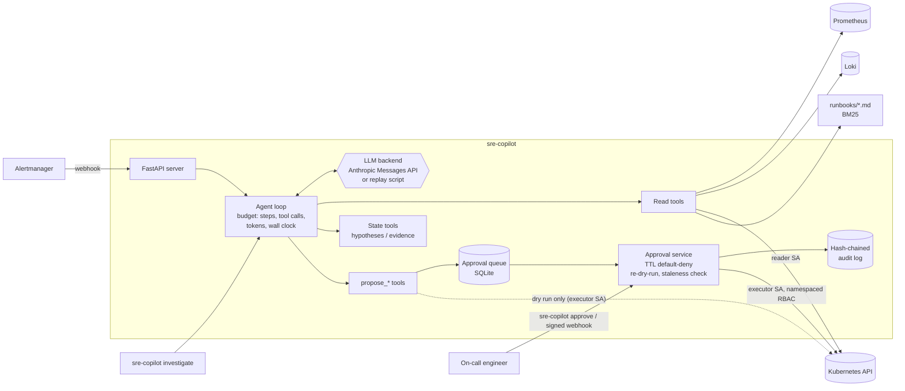
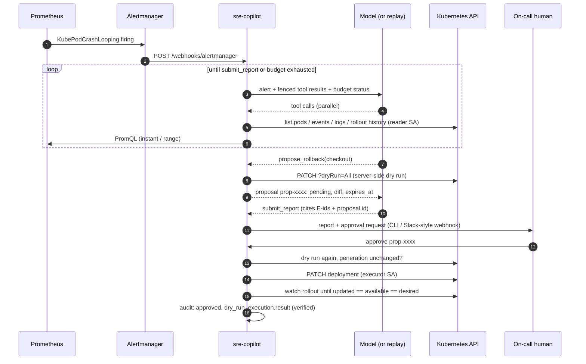

# sre-copilot

[](https://github.com/RatulSikder97/sre-copilot/actions/workflows/ci.yml)


**An agentic incident-response copilot that investigates alerts with read-only tools and
proposes remediations behind a human approval gate. It never silently changes production.**

An Alertmanager webhook (or `sre-copilot investigate "<symptom>"`) starts a bounded tool-use
loop on the Anthropic Messages API. The agent queries Prometheus, Loki and Kubernetes, correlates
with recent rollouts, searches your runbooks, keeps explicit hypotheses, and submits a
structured incident report in which every claim cites an evidence id. Remediations
(`rollout restart`, `rollback`, `scale`) are only *proposals*: each one is checked with a
Kubernetes **server-side dry run**, queued, and executed by a separate, namespace-scoped
service account only after a person approves it. Unapproved proposals expire (default deny).
Every step lands in a hash-chained audit log.

The whole system runs without an API key or a cluster in **replay mode**: a scripted stand-in
for the model plus tool outputs recorded from a real kind cluster. That is what CI runs, and what
the sample report below comes from.

```text
alert ─► investigate (read-only tools, budget-capped) ─► report + proposal (dry run)
      ─► human approves ─► executor SA applies ─► rollout verified ─► audit log
```

## Contents

- [Architecture](#architecture)
- [Sample incident report (real run, replay mode)](#sample-incident-report)
- [Safety model](#safety-model)
- [Quickstart](#quickstart)
- [Configuration](#configuration)
- [Extending: add a tool or a runbook](#extending)
- [Project layout](#project-layout)

## Architecture





**Agent loop** (`src/sre_copilot/agent.py`): manual tool-use loop over the Messages API
(`claude-sonnet-5-5` by default). Parallel tool calls are executed and returned in one user
turn, followed by a `[budget]` status line so the model can pace itself. When any budget is
exhausted the model gets one final turn with only `submit_report` available; if it still does not
submit, the run ends as `budget_exhausted`. The frozen system prompt carries a cache breakpoint
(covering the deterministic tool list), and top-level automatic caching covers the growing history.
Effort is configurable (`medium` by default), server-side refusal fallback is enabled, and the SDK
retries 429/5xx with backoff; non-retryable API errors end the run with an `error` report.

**Structured state**: `record_hypothesis` / `update_hypothesis` keep hypotheses with status
(open, supported, ruled out), confidence and evidence. Every read-tool result is stored as
evidence `E1, E2, ...` with a summary and, where possible, a deep link (Prometheus graph, Loki
query). `submit_report` is validated against a pydantic schema, and rejected if it cites evidence
ids or proposal ids that do not exist in the run.

| Tool | Kind | Backend |
|---|---|---|
| `prometheus_query`, `prometheus_query_range` | read | Prometheus HTTP API |
| `loki_query` | read | Loki `query_range` (LogQL built from validated fields) |
| `k8s_list_pods`, `k8s_events`, `k8s_describe`, `k8s_pod_logs`, `k8s_rollout_history` | read | official `kubernetes` client, reader SA |
| `recent_deploys` | read | ReplicaSet history (+ `git log` if `SRE_COPILOT_GIT_REPO` is set) |
| `runbook_search` | read | local markdown, Okapi BM25 |
| `record_hypothesis`, `update_hypothesis`, `submit_report` | state | in-process |
| `propose_rollout_restart`, `propose_rollback`, `propose_scale` | action (proposal only) | approval queue + server-side dry run |

## Sample incident report

This is unedited output (headings demoted) from a real run of `make demo-up && make demo-run SCENARIO=crashloop` against the kind cluster: the fault
injector shipped a "deploy v2" with `DB_POOL_SIZE=2O` (letter O), Prometheus fired
`KubePodCrashLooping`, the alert was posted to the copilot's Alertmanager webhook, and the
investigation ran in **replay mode**: the model turns are scripted (`scenarios/checkout-crashloop/script.yaml`;
no LLM was called, there is no API key on the machine that produced this), while **every tool
call hit the live cluster**: the pod states, log lines, rollout history, PromQL results and the
dry-run diff below are real. Replay scripts assert on tool outputs (`expect:`), so a run whose
environment does not match the script fails instead of producing a misleading report.

### checkout v2 rollout crash-loops on invalid DB_POOL_SIZE

> **REPLAY MODE** - scripted model turns (no LLM call); tool outputs are live.
> `inv-20261124-042914-fd20` | status **complete** | model `replay:checkout-crashloop` | 7 steps, 18 tool calls, ~34355 tokens, 2.4s

**Severity:** SEV2

#### Summary
The checkout rollout "deploy v2: tune DB connection pool" set DB_POOL_SIZE to "2O" (letter O instead of zero). The service parses this value with int() at startup, logs "invalid configuration" and exits with code 1, so every pod of the new ReplicaSet enters CrashLoopBackOff and the rollout is stuck.

#### Impact
Degraded, not down: with maxUnavailable=0 the previous revision's pods keep serving (2/2 available, E9), but the deployment runs without surge capacity, the rollout is blocked, and any scale-up or node drain would schedule pods from the broken template.

#### Timeline
- `T0` Rollout of "deploy v2: tune DB connection pool (DB_POOL_SIZE=2O)" [E4, E5]
- `T0 + seconds` New pod exits on startup with "invalid configuration" for DB_POOL_SIZE='2O' [E6, E7]
- `T0 + ~1m` Pod enters CrashLoopBackOff; BackOff events; KubePodCrashLooping fires [E1, E2, E3]
- `T0 + ~2m` Rollback to the previous (serving) revision proposed after a server-side dry run; awaiting approval

#### Root cause hypothesis
**Invalid configuration value DB_POOL_SIZE=2O shipped in the checkout "deploy v2" rollout** (confidence 93%) [E1, E4, E6, E7, E8]

Only pods from the newest ReplicaSet crash (E1). The single change in that revision is the DB_POOL_SIZE value (E4). The previous container instance logs an int() parse failure for exactly that key before exiting (E6), consistently across restarts (E7). OOM was ruled out (E8) and the dependency hypothesis is inconsistent with the process exiting before any connection attempt.

#### Hypotheses considered
- **H1** (supported, 93%) The latest checkout rollout introduced a change that makes new pods exit on startup. [E1, E4, E6, E7]
  - The "deploy v2" revision sets DB_POOL_SIZE=2O; every crashed instance exits on int() parsing of that value.
- **H2** (ruled out, 2%) New pods are killed for exceeding their memory limit (OOMKilled). [E1, E8]
  - No OOMKilled terminations; containers exit with code 1, not 137.
- **H3** (ruled out, 3%) A dependency (orders database) is unavailable, so the process fails during startup. [E6, E7]
  - The process exits during config validation, before any connection attempt.

#### Proposed remediation
1. Approve the rollback of deployment/checkout to the last healthy revision _(risk: low)_ -> proposal `prop-bbfa64b2`
2. Confirm the rollout completes and restart counts stop increasing; KubePodCrashLooping should resolve _(risk: low)_
3. Fix the value to 20 in the config source and redeploy through CI _(risk: low)_

#### Approval queue
| proposal | action | status | dry run | expires |
|---|---|---|---|---|
| `prop-bbfa64b2` | rollback deployment/checkout -n demo to revision 1 | pending | server-side dry run OK: rollback deployment/checkout -n demo to revision 1 ('deploy v1: initial release') | 2026-11-24 04:44:17Z |

Dry-run diff for `prop-bbfa64b2`:
```diff
~ env.checkout.APP_VERSION: 'v2' -> 'v1'
~ env.checkout.DB_POOL_SIZE: '2O' -> '20'
```

Approve with `sre-copilot approve <proposal>`; unapproved proposals expire (default deny).

#### Evidence
- **E1** `k8s_list_pods`: 3 pods in demo (app=checkout); 1 unhealthy; waiting reasons: CrashLoopBackOff; last terminations: Error (exit 1)
- **E2** `k8s_events`: 21 recent events in demo; 4 warnings (BackOff, Unhealthy)
- **E3** `prometheus_query`: PromQL `max by (pod) (max_over_time(kube_pod_container_status_waiting_reason{namespace="demo", reason="CrashLoopBackOff"}[5m]))` -> 1 series; first={pod="checkout-5fb575f664-v6c2q"} value=1 ([link](http://127.0.0.1:39090/graph?g0.expr=max+by+%28pod%29+%28max_over_time%28kube_pod_container_status_waiting_reason%7Bnamespace%3D%22demo%22%2C+reason%3D%22CrashLoopBackOff%22%7D%5B5m%5D%29%29&g0.tab=0&g0.range_input=30m))
- **E4** `k8s_rollout_history`: deployment/checkout: current revision 2, 2 revisions; latest change-cause: 'deploy v2: tune DB connection pool (DB_POOL_SIZE=2O)' at 2026-11-24T04:24:02Z
- **E5** `recent_deploys`: 2 rollouts in demo in the last 120m; newest: checkout rev 2 at 2026-11-24T04:24:02Z
- **E6** `k8s_pod_logs`: 2 previous log lines from pod/checkout-5fb575f664-v6c2q; last: {"ts": "2026-11-24T04:27:10Z", "level": "fatal", "service": "checkout", "version": "v2", "msg": "refusing to start with invalid configuration; exiting", "exit_c
- **E7** `loki_query`: LogQL `{namespace="demo", app="checkout"} |= "invalid configuration"` over 30m -> 12 lines; latest: {"ts": "2026-11-24T04:27:10Z", "level": "fatal", "service": "checkout", "version": "v2", "msg": "refusing to start with invalid configuration; exiting", "exit_c ([link](http://127.0.0.1:39100/loki/api/v1/query_range?query=%7Bnamespace%3D%22demo%22%2C+app%3D%22checkout%22%7D+%7C%3D+%22invalid+configuration%22))
- **E8** `prometheus_query`: PromQL `kube_pod_container_status_last_terminated_reason{namespace="demo", reason="OOMKilled"} == 1` -> 0 series ([link](http://127.0.0.1:39090/graph?g0.expr=kube_pod_container_status_last_terminated_reason%7Bnamespace%3D%22demo%22%2C+reason%3D%22OOMKilled%22%7D+%3D%3D+1&g0.tab=0&g0.range_input=30m))
- **E9** `k8s_describe`: deployment/checkout rev 2: 2/2 available, 1 unavailable, images=['python:3.12-alpine']
- **E10** `runbook_search`: runbook search 'CrashLoopBackOff after rollout bad config rollback' -> CrashLoopBackOff after a rollout (runbooks/crashloopbackoff.md), Container OOMKilled (runbooks/oomkilled.md)

#### Runbooks
- `runbooks/crashloopbackoff.md` (cited)
- `runbooks/oomkilled.md` (retrieved)

#### Follow-ups
- Validate service configuration (types and ranges) in CI before deploy.
- Add a startup smoke check to the deploy pipeline so a crash-looping revision is halted automatically.

After the report, the demo approves the proposal the way an on-call engineer would:

```text
$ sre-copilot approve prop-bbfa64b2 --actor demo-operator
prop-bbfa64b2  [executed]  rollback deployment/checkout -n demo to revision 1
  investigation: inv-20261124-042914-fd20
  reason:        The "deploy v2" revision introduced DB_POOL_SIZE=2O, which fails integer parsing and crash-loops every new pod (E4, E6, E7). The previous revision is still serving. Rolling back restores the last known-good template.
  dry run:       server-side dry run OK: rollback deployment/checkout -n demo to revision 1 ('deploy v1: initial release')
    ~ env.checkout.APP_VERSION: 'v2' -> 'v1'
    ~ env.checkout.DB_POOL_SIZE: '2O' -> '20'
  expires:       2026-11-24T04:44:17.521283+00:00
  decided by:    demo-operator at 2026-11-24 04:29:21.832465+00:00
  execution:     applied: rollback deployment/checkout -n demo to revision 1
  verification:  rollout complete: generation 3/3, updated 2/2, available 2/2, unavailable 0
==> verifying recovery
deployment "checkout" successfully rolled out
NAME                        READY   STATUS    RESTARTS   AGE
checkout-85dd8c76d6-5hxmn   1/1     Running   0          5m55s
checkout-85dd8c76d6-ttzgk   1/1     Running   0          5m55s
$ sre-copilot audit verify
audit log intact
$ sre-copilot audit show   # details column omitted
2026-11-24T04:29:17.525746+00:00  proposal.created     sre-copilot
2026-11-24T04:29:21.832745+00:00  proposal.approved    demo-operator
2026-11-24T04:29:22.151253+00:00  execution.dry_run    demo-operator
2026-11-24T04:29:24.207646+00:00  execution.result     demo-operator
```

## Safety model

The full threat model is in [`docs/threat-model.md`](docs/threat-model.md). The short version:

| Control | Where |
|---|---|
| The model can only **propose**; `execute` is reachable only from `ApprovalService.approve` | `approval/service.py` |
| Server-side dry run (`dryRun=All`) at proposal time **and** again right before execution | `approval/executor.py` |
| Proposals expire (`SRE_COPILOT_APPROVAL_TTL_SECONDS`, default 15 min) = **default deny** | `approval/service.py` |
| Compare-and-set state transitions: no double execution; stale proposals (deployment `generation` changed since the dry run) are refused | `approval/store.py`, `executor.py` |
| Rollback target pinned at proposal time: approval executes exactly what was reviewed | `approval/service.py` |
| Least privilege: separate reader and executor service accounts, **RoleBindings in allowlisted namespaces only**, no Secret access, no delete/exec; verified with `kubectl auth can-i` in every demo run | `deploy/rbac/rbac.yaml` |
| Namespace allowlist and name/selector validation in code before any API call | `safety.py` |
| Tool output is untrusted: fenced in `<tool_output trust="untrusted">`, embedded fence tags neutralised, truncated | `safety.py`, `agent.py` |
| Secret redaction on every tool output, fixture, audit entry and alert text | `safety.py` |
| Grounding: reports citing unknown evidence/proposal ids are rejected | `agent.py` |
| Budget caps on steps, tool calls, tokens and wall clock | `agent.py` |
| Signed (HMAC-SHA256, 5-minute replay window) webhook approvals; bearer token on ingest | `server.py` |
| Hash-chained audit log, `sre-copilot audit verify` | `approval/store.py` |

## Quickstart

Requirements: Python 3.12, [uv](https://docs.astral.sh/uv/). For the demo: Docker, `kind`,
`kubectl`.

```bash
git clone https://github.com/RatulSikder97/sre-copilot && cd sre-copilot
make install
make check                     # ruff + mypy --strict + pytest (offline)
make replay SCENARIO=crashloop # replay a recorded incident: no API key, no cluster
make replay SCENARIO=oom
```

### Full demo on kind

```bash
make demo-up                       # kind cluster "sre-copilot", Prometheus, Loki, promtail,
                                   # kube-state-metrics, sample app, RBAC (~3 min)
make demo-run SCENARIO=crashloop   # fault -> alert -> webhook -> investigate -> approve -> verify
make demo-run SCENARIO=oom         # memory-leak rollout -> OOMKilled -> rollback
make demo-down                     # delete the cluster and local demo state
```

`demo-run` defaults to `MODE=replay`. With an API key, `MODE=live` runs the same flow with the
model choosing its own tool calls:

```bash
export ANTHROPIC_API_KEY=...
make demo-run SCENARIO=crashloop MODE=live
```

Prometheus is on `127.0.0.1:39090` and Loki on `127.0.0.1:39100` while the cluster is up.
The demo stands in for Alertmanager routing with `sre-copilot fire-alert`, which waits for the
Prometheus alert to fire and posts it in Alertmanager v4 webhook format to the running server.

### Against your own cluster

```bash
export ANTHROPIC_API_KEY=...
export SRE_COPILOT_ALLOWED_NAMESPACES=payments,checkout
export SRE_COPILOT_PROMETHEUS_URL=http://prometheus.monitoring:9090
export SRE_COPILOT_LOKI_URL=http://loki.monitoring:3100
export SRE_COPILOT_KUBECONFIG_READ=~/.kube/sre-copilot-reader
export SRE_COPILOT_KUBECONFIG_WRITE=~/.kube/sre-copilot-executor
uv run sre-copilot investigate "checkout p99 latency doubled after 14:00"
uv run sre-copilot proposals --status pending
uv run sre-copilot show <proposal-id>
uv run sre-copilot approve <proposal-id>
```

Run the webhook server with `uv run sre-copilot serve --host 0.0.0.0 --port 8080` and point an
Alertmanager receiver at it:

```yaml
receivers:
  - name: sre-copilot
    webhook_configs:
      - url: http://sre-copilot:8080/webhooks/alertmanager
        http_config:
          authorization:
            credentials: <SRE_COPILOT_ALERTMANAGER_TOKEN>
```

Approvals over HTTP (e.g. from a Slack interactivity handler) are signed like Slack requests:

```bash
body='{"decision":"approve","actor":"alice"}'
ts=$(date +%s)
sig="v1=$(printf 'v1:%s:%s' "$ts" "$body" | openssl dgst -sha256 -hmac "$SRE_COPILOT_APPROVAL_SIGNING_SECRET" | cut -d' ' -f2)"
curl -X POST localhost:8080/proposals/<id>/decision \
  -H "x-copilot-request-timestamp: $ts" -H "x-copilot-signature: $sig" \
  -H 'content-type: application/json' -d "$body"
```

## Configuration

All settings are environment variables with the `SRE_COPILOT_` prefix (or a `.env` file; see
[`.env.example`](.env.example)).

| Variable | Default | Meaning |
|---|---|---|
| `MODEL` | `claude-sonnet-5-5` | Anthropic model |
| `EFFORT` | `medium` | `output_config.effort` |
| `LLM` | `anthropic` | `anthropic` or `replay` (with `REPLAY_SCRIPT`) |
| `TOOLS` | `live` | `live` or `fixtures` (with `FIXTURES_PATH`) |
| `RECORD_PATH` | unset | record read-tool outputs and dry runs as fixtures |
| `MAX_STEPS` / `MAX_TOOL_CALLS` / `MAX_TOTAL_TOKENS` / `MAX_WALL_SECONDS` | 16 / 40 / 400000 / 300 | budget caps |
| `ALLOWED_NAMESPACES` | `demo` | comma-separated allowlist |
| `KUBECONFIG_READ` / `KUBECONFIG_WRITE` | default kubeconfig | reader / executor credentials |
| `PROMETHEUS_URL` / `LOKI_URL` | `127.0.0.1:39090` / `:39100` | backends (`*_PUBLIC_URL` for links) |
| `APPROVAL_TTL_SECONDS` | 900 | proposal lifetime before default deny |
| `APPROVAL_SIGNING_SECRET` | unset | enables signed HTTP decisions |
| `ALERTMANAGER_TOKEN` | unset | bearer token required on the webhook |
| `NOTIFY_WEBHOOK_URL` | unset | Slack-compatible incoming webhook for new proposals |
| `MAX_SCALE_REPLICAS` | 20 | upper bound for `propose_scale` |
| `STATE_DIR` | `.sre-copilot` | SQLite queue and audit log |

## Extending

### Add a read tool

1. Define a pydantic argument model (validate anything that reaches a backend) and a handler
   returning `ToolResult(output=..., summary="one line for the evidence list", link=...)`.
2. Register it in `Toolbox.read_tools()` (`src/sre_copilot/tools/toolbox.py`).

```python
class PagerDutyArgs(BaseModel):
    service: str = Field(pattern=r"^[A-Za-z0-9_-]{1,64}$")

def recent_incidents(args: PagerDutyArgs) -> ToolResult:
    incidents = pagerduty.list_incidents(service=args.service, since="2h")
    return ToolResult(output={"incidents": incidents}, summary=f"{len(incidents)} incidents")

Tool("pagerduty_incidents", "Recent PagerDuty incidents for a service.", PagerDutyArgs,
     recent_incidents)
```

Outputs are redacted, fenced as untrusted, truncated, turned into evidence and recorded in
fixtures automatically. Exceptions become `is_error` tool results; they never crash the loop.

### Add an action

Add an `ActionKind`, implement it in `KubeExecutor._patch` (it must support `dry_run="All"`),
add a `propose_*` tool in `tools/actions.py` and validation in `ApprovalService.validate`, and
grant the executor role only the verbs it needs.

### Add a runbook

Drop a markdown file in `runbooks/` with a `# Title` line. It is indexed with BM25 at startup;
titles are weighted double. Check retrieval with
`uv run sre-copilot runbooks search "your symptom"`.

### Record a new replay scenario

Write `scenarios/<name>/script.yaml` (turns, tool calls, `expect:` substrings), run it once
against a real environment with `--record scenarios/<name>/fixtures.json`, save the alert payload
as `alert.json`, and add the scenario to `tests/test_scenarios.py`.

## Project layout

```text
src/sre_copilot/
  agent.py            bounded tool-use loop, state tools, report assembly
  llm/                Anthropic backend, deterministic replay backend
  tools/              Prometheus, Loki, Kubernetes, runbooks (BM25), propose_* actions
  approval/           SQLite queue, executor (server-side dry run, verify), audit log
  server.py           FastAPI: Alertmanager webhook, results, signed decisions
  cli.py              investigate / serve / proposals / approve / deny / audit / fire-alert
  safety.py           redaction, untrusted fencing, allowlists
deploy/               kind config, Prometheus + rules, Loki, promtail, kube-state-metrics,
                      sample app with fault knobs, RBAC
scenarios/            replay scripts + fixtures recorded from the kind cluster
runbooks/             markdown runbooks
docs/threat-model.md
```

## License

MIT
